# Graph Neural Networks from Scratch using pytorch only

I wrote GCN, GraphSAGE, GAT and GIN in **plain PyTorch — no PyG, no DGL** and
then tested each one is numerically identical to `torch_geometric` by copying
the weights across and comparing outputs in float64. Every number in this README
comes from a real run uisng the free Kaggle Tesla T4; the executed
notebook with all outputs is also in `kaggle/` and every figure is available in `results/` folder.

The whole subject is three lines:

```
message[e] = f(x[src[e]])          # gather from the sender
out[dst[e]] += message[e]          # scatter onto the receiver
x' = update(out, x)                # combine with the node's own state
```

Every architecture here is just a different choice of `f`, the aggregation
operator, and `update`. My goal was not to beat the current leaderboard but was to be
able to write a graph convolution from its definition and know, with evidence,
that it was correct.

---

## What I built

| | |
|---|---|
| **Models** | GCN, GraphSAGE (mean/max/sum), GAT (multi-head), GIN — all hand-written |
| **Task 1** | semi-supervised node classification on **Cora** (2708 papers, 7 classes, 140 labels) |
| **Task 2** | graph-level classification on **MUTAG** (188 molecules) + a synthetic triangle-detection task (a deliberate negative result) |
| **Verification** | every layer and the Cora loader checked against `torch_geometric` in float64 — **27 checks, all exact** |
| **Experiments** | depth / over-smoothing, aggregator choice, self-loops, duplicate edges, attention analysis |
| **Tests** | 90 test functions (105 parametrized cases): hand-computed layer outputs, scatter primitives vs brute-force loops, static AST checks, and mutation tests that prove the equivalence checks can fail |
| **Runtime** | ~10–15 min for everything on a T4; Cora alone trains in seconds on CPU |

Deliberately **out of scope** to keep the project focused: neighbour sampling,
heterogeneous graphs, edge features, link prediction, graph transformers.

---

## Results (real numbers from that Kaggle run)

Environment: Python 3.13.16 · PyTorch 2.11.0+cu130 · Tesla T4 · torch_geometric 2.8.1.

### Cora — node classification (test accuracy at the best validation epoch, mean ± std over 3 seeds)

| model | paper | my run | macro-F1 | params |
|---|---|---|---|---|
| GCN (Kipf & Welling 2017) | 81.5% | **80.27 ± 0.45%** | 79.38 ± 0.32% | 23,063 |
| GraphSAGE (Hamilton 2017) | ~81.6% | **79.20 ± 0.16%** | 78.35 ± 0.36% | 46,103 |
| GAT (Veličković 2018) | 83.0 ± 0.5% | **80.43 ± 0.83%** | 79.88 ± 0.75% | 184,725 |
| **majority-class baseline** | — | **31.90%** | — | 0 |

A single Cora run has ~1% seed variance, so comparing architectures on one seed
each is close to meaningless — that is why everything is 3 seeds.

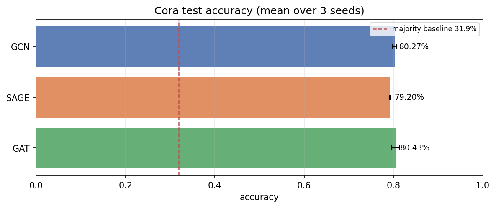

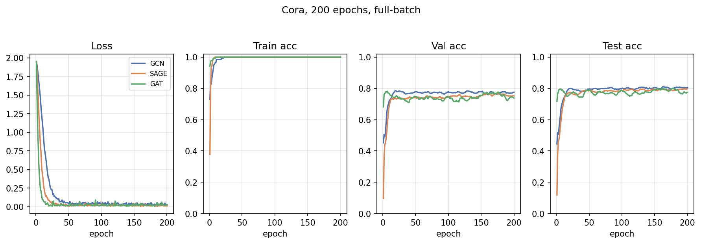

### MUTAG — graph classification (GIN, 5-fold CV)

| readout | my run | note |
|---|---|---|
| **sum** | **76.10 ± 11.23%** | published GIN ≈ 75–85% — in range |
| mean | 73.88 ± 6.77% | |
| max | 70.75 ± 10.38% | |
| **majority baseline** | **66.49%** | MUTAG is 63 vs 125 — *not* 50% |

The high std is real: with only 188 molecules, one fold's test set can swing the
mean by ~10 points. The honest statement is "sum ≥ mean ≥ max, all barely above
the 66.5% majority baseline" — not "GIN gets 76%".

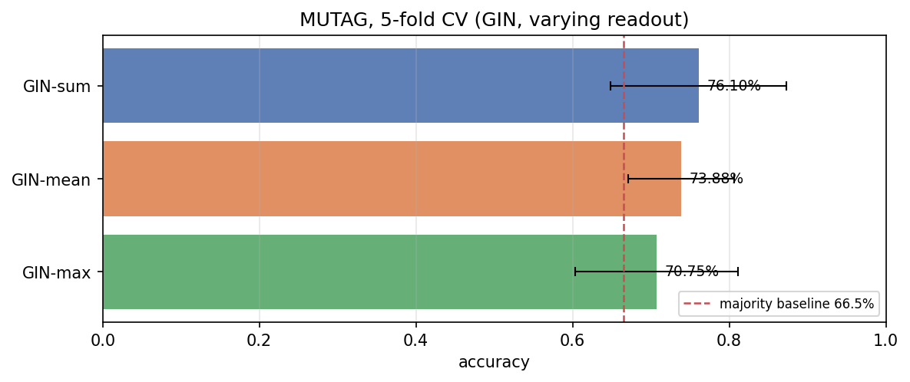

### Triangle detection — a negative result I kept on purpose

| readout | my run (3-fold CV) | expected |
|---|---|---|
| mean | 50.24 ± 1.54% | ≈ chance (50%) |
| sum | 47.77 ± 2.67% | ≈ chance (50%) |
| max | not run in this sweep | ≈ chance |

The label here is "does this graph contain a 3-cycle?". The classes are built in
**matched pairs** — same node count, same edge count, the positive graph is the
negative one with a single edge moved — so size and density carry no signal.
Detecting a triangle is beyond what 1-WL message passing can do, so near-chance
is the *correct* result. This is a check that the data has no shortcut, not a
benchmark so please see [What I learned](#what-i-learned) for the first version that
"worked" because of a leak.

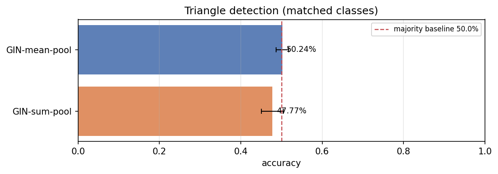

---

## How I proved the code is correct

Writing a GNN from scratch is easy. Writing one that is *right* is not, because
**the failure mode is silent**. Swap `src` and `dst` in a message pass and the
shapes stay valid, the model still trains, the loss still decreases and the
accuracy still looks plausible. Nothing throws. That happened in my first draft
of `GCNConvScratch` and a test caught it — not a runtime error.

So correctness is established in three independent ways.

### 1. Numerical equivalence with PyTorch Geometric — 27 checks, all exact

Same layer built in PyG, weights copied across verbatim, outputs compared in
**float64**:

```
max | mine(x, edge_index) - pyg(x, edge_index) |  =  0.000e+00  (< 1e-10)
```

float64 matters. In float32 a `1e-5` tolerance passes even for a subtly wrong
implementation; agreement to `~1e-12` (here: exactly 0.0) is evidence the two
compute the same *expression*. This works at all because `gnn_lab` names
parameters the way PyG does — `lin`/`bias` for GCN, `lin_l`/`lin_r` for SAGE,
`lin`/`att_src`/`att_dst`/`bias` for GAT, `nn`/`eps` for GIN — so the check is
`pyg.load_state_dict(mine.state_dict())`, not a brittle key mapping.

```bash
python scripts/run_selftest.py --with-data
```

My T4 run: **27 passed / 0 failed / 0 skipped** — scatter primitives,
`gcn_norm`, all four layer types, three SAGE aggregators, three GAT
head/concat configurations, all three pooling operators, and the full Cora
loader (features, labels, edge ordering, all three masks) against `Planetoid`.

### 2. Hand-computed outputs on a 5-node regular graph

`tests/test_layers.py` uses a 5-node **degree-regular** graph, so every GCN
coefficient is exactly `1/3` and every expected value can be written on paper:

```
out[0] = (x0 + x1 + x3)/3 = ([1,0] + [0,1] + [2,0])/3 = [1.0000, 0.3333]
```

GCN, SAGE (all three aggregators), GIN and GAT are each asserted against those
values. The sharpest check: GAT with zeroed attention vectors must reproduce GCN
bit-for-bit, because uniform attention over a regular graph *is* the symmetric
normalisation.

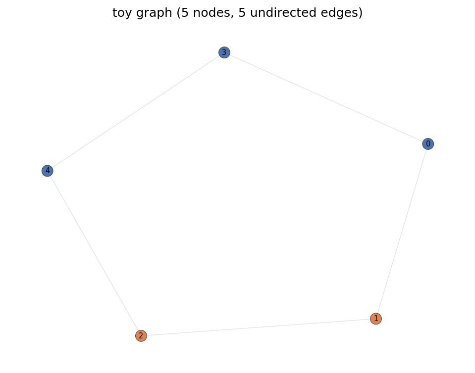

### 3. Static checks that need no dependencies

`tests/test_index_convention.py` parses the AST of every layer and enforces that
`scatter_*` always receives a **destination** index and every `forward` gathers
from a **source** index. It runs without torch installed, and it is the specific
guard against the `src`/`dst` swap above.

```bash
pytest                       # offline, fast, no downloads
pytest -m network            # dataset tests (downloads ~1.5 MB once)
```

---

## What the experiments showed

### Over-smoothing is diffusion, and it is measurable (depth sweep, plain GCN)

Message passing pulls neighbouring representations together every layer. Two
numbers track it: **mean pairwise cosine similarity** climbs toward 1.0 and
**graph Dirichlet energy** $\sum_{(i,j)\in E}\|h_i-h_j\|^2$ falls toward 0. When
both saturate, every node has the same representation.

| layers | test acc | mean cosine sim | Dirichlet energy |
|---|---|---|---|
| 1 | 74.9% | 0.237 | 22.4 |
| 2 | 80.0% | 0.190 | 8.1 |
| 3 | 81.1% | 0.243 | 154 |
| 4 | 75.5% | 0.218 | 492 |
| 6 | 68.5% | 0.295 | 648 |
| **8** | **31.1%** | **0.860** | **2.2e-3** |
| 12 | 31.0% | 0.844 | 5.8e-4 |

At 8 layers the model collapses to the 31.9% majority baseline. The t-SNE
panels below show the class clusters merging into one blob as layers stack.
*(This run swept plain GCN to 12 layers; residual and Jumping-Knowledge
connections are the obvious next experiment but were not run here.)*

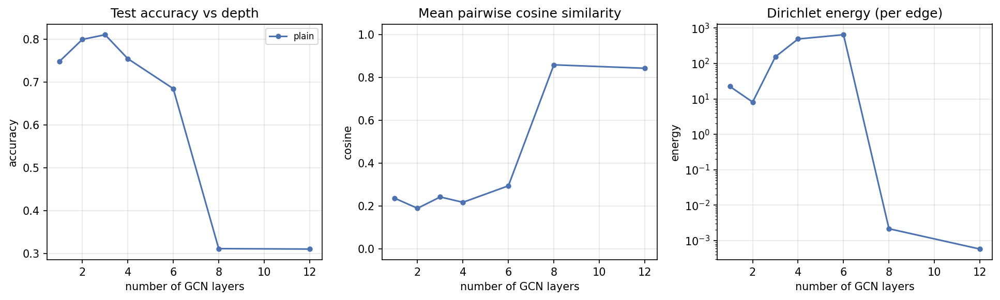

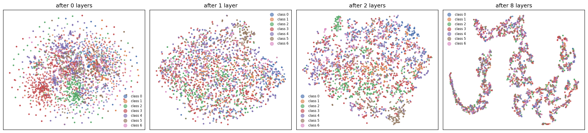

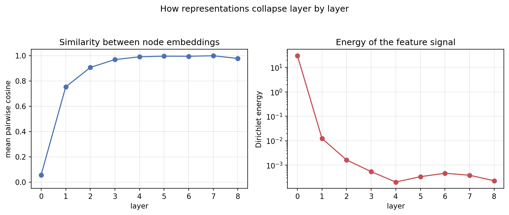

### Aggregator, self-loop and duplicate-edge ablations

- **Aggregator (GraphSAGE, 2 layers):** mean 79.2% > max 76.7% > sum 73.5%. On
  homophilous Cora, mean wins.
- **Self-loops (GCN):** on 80.0% vs off 79.9%. A 0.1-point difference — real but
  tiny, and most tutorials treat it as make-or-break.
- **Duplicate edges:** Cora's raw adjacency contains **10858** entries for
  **10556** unique directed edges — 302 duplicates from 151 reciprocal pairs
  stored twice. Duplicates inflate degrees, and degree is exactly what GCN
  divides by. Deduped (PyG behaviour): 80.0%; with duplicates (original
  `tkipf/gcn` behaviour): 79.8%. Small, but measured rather than assumed.

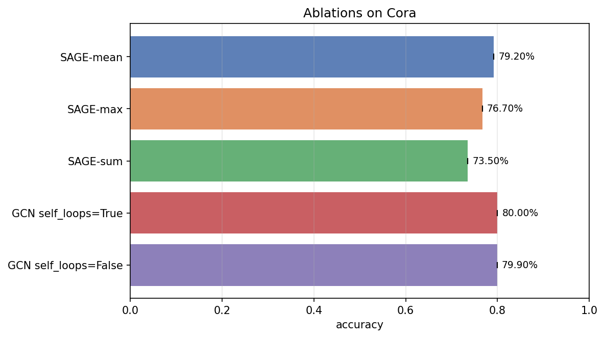

### Attention is a soft nudge, not an edge classifier

Splitting GAT's learned coefficients into same-class and cross-class edges:
same-class mean **0.2095** vs cross-class **0.1744**, ratio **1.20**. The
distributions overlap heavily, and all 8 heads agree (each head's ratio is also
~1.20 — no specialisation). That is the honest result, and a useful corrective
to figures that make attention look like a perfect edge selector.

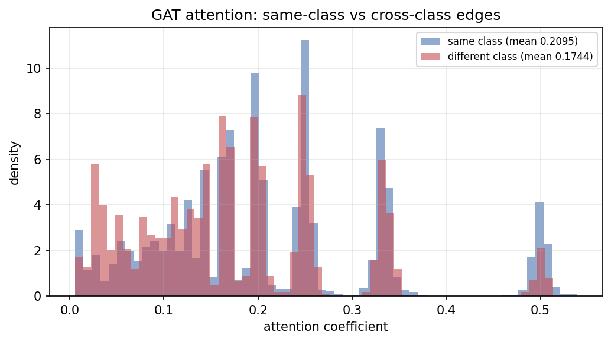

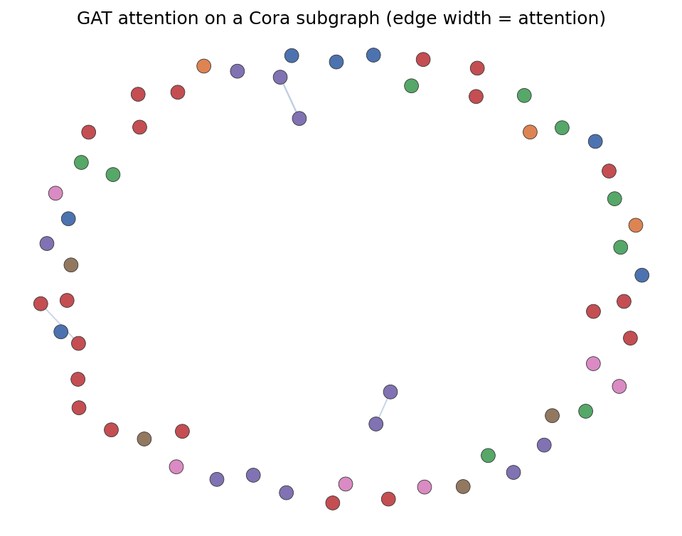

---

## What I learned (the things that silently break)

Collected the hard way. None of these raise an exception.

| trap | symptom | how I caught it |
|---|---|---|
| `src`/`dst` swapped in a message pass | trains fine, accuracy a few points low | static AST test + directed-graph equivalence test |
| Cora's `test.index` is unsorted | evaluating on a relabelled test set | `data/cora.py`, documented + tested |
| 302 duplicate adjacency entries in Cora | inflated degrees → wrong GCN normalisation | `dedupe=` switch, ablated above |
| `scatter_mean` on an isolated node | `NaN` loss, usually several epochs in | count clamped at 1, tested explicitly |
| GAT split into `lin_src`/`lin_dst` | 2× parameters, a different model than the paper | `separate_lin=False` default, tested |
| Reporting max test accuracy over epochs | inflated by 1–2 points | both numbers recorded; only the honest one (best-val epoch) reported |
| Forgetting MUTAG's 66.5% baseline | "75% accuracy" that beats nothing | `majority_accuracy()` printed everywhere |
| A dataset leak in the triangle task | `sum` appeared to beat `mean` at 88% | rebuilt classes as matched pairs; the "win" vanished to chance |

The triangle leak is the one I keep coming back to. The first version showed
`sum` pooling beating `mean`, which looked like the Weisfeiler-Lehman bound
turning into a number. It was a leak: triangle-free random graphs only survive
rejection sampling when they are sparse, so the "no triangle" class had ~21
edges against ~34, and **edge density alone predicted the label at 88%** with no
GNN at all. Rebuilding the data as matched pairs drops that shortcut to exactly
50%, and with it the "win". The lesson is the same as the `src`/`dst` swap:
**a result that matches the story you wanted is the one to check hardest.**

---

## Layout

```
gnn-from-scratch/
├── gnn_lab/                     # the library — source of truth
│   ├── ops.py                   # scatter_add/mean/max/softmax, gcn_norm, edge surgery
│   ├── layers/                  # gcn, sage, gat, gin, pooling — hand-written
│   ├── data/                    # cora (Planetoid + LINQS), tu (MUTAG), synthetic
│   ├── train.py                 # node + graph classification trainers
│   ├── metrics.py               # accuracy, macro-F1, over-smoothing diagnostics
│   ├── equivalence.py           # the from-scratch vs PyG proof
│   ├── viz.py                   # plots
│   └── utils.py                 # seeding, device, parameter counts
├── notebooks/                   # 5 chapter notebooks, import gnn_lab
├── kaggle/
│   ├── gnn_from_scratch_t4.ipynb          # self-contained template (no outputs) — upload & Run All
│   └── gnn_from_scratch_t4_executed.ipynb # my real T4 run, with all outputs + figures
├── scripts/                     # CLI entry points (train, selftest, ablations, notebook builder)
├── tests/                       # hand-computed + AST + equivalence tests
└── results/                     # the 12 figures above, committed (see results/README.md)
```

The `kaggle/` template notebook is **generated** from the package by
`scripts/build_kaggle_notebook.py`, so the two copies cannot drift apart.

---

## Quick start

```bash
git clone https://github.com/naveed1011/gnn-from-scratch.git
cd gnn-from-scratch
python -m venv .venv && source .venv/bin/activate   # Windows: .venv\Scripts\activate
pip install -r requirements.txt          # add -r requirements-pyg.txt for the equivalence checks
pip install -e .
python scripts/run_selftest.py           # is the from-scratch code correct?
python scripts/train_node_classification.py
```

Minimal example:

```python
from gnn_lab import load_cora, GCNScratch, train_node, set_seed
set_seed(0)
data = load_cora()                                            # downloads ~1 MB once
model = GCNScratch(data.num_features, 16, data.num_classes)   # 2 layers, 16 hidden
result = train_node(model, data, model_name="GCN", epochs=200)
print(result.summary_line())
```

**Requirements:** Python ≥ 3.10, PyTorch ≥ 2.0. `torch_geometric` is **optional**
— used only as a reference oracle for the equivalence checks. `scipy` is needed
for the Planetoid loader; without it, `load_cora(source="linqs")` gives the same
graph from plain text with no scipy at all.

## Running on Kaggle (free T4)

`kaggle/gnn_from_scratch_t4.ipynb` is fully self-contained — the entire library
is inlined, so it needs no repository checkout.

1. kaggle.com → **New Notebook**
2. Upload that file (or paste its contents)
3. Right panel → **Accelerator** → **GPU T4 x2**
4. **Run All** (~10–15 min)

It installs `torch_geometric` itself for the equivalence section and degrades
gracefully if that fails. Everything runs on CPU too — Cora is small — in
roughly 25 minutes. Figures are written to `results/`; use **Output → Download**
to keep them.

## Reproducing everything

```bash
make selftest        # equivalence checks vs torch_geometric
make test            # full offline test suite
make results         # Cora + MUTAG + ablations -> results/*.json and figures
make notebook        # regenerate kaggle/gnn_from_scratch_t4.ipynb from the package
make all             # everything above
```

Seeding is handled by `gnn_lab.utils.set_seed`. Bitwise reproducibility on CUDA
additionally requires `torch.use_deterministic_algorithms(True)` (opt-in, slower);
scatter reductions are non-deterministic in float order by default, so expect
small run-to-run variation even with a fixed seed.

---

## References

- Kipf & Welling. *Semi-Supervised Classification with Graph Convolutional
  Networks.* ICLR 2017.
- Hamilton, Ying & Leskovec. *Inductive Representation Learning on Large
  Graphs.* NeurIPS 2017.
- Veličković et al. *Graph Attention Networks.* ICLR 2018.
- Xu et al. *How Powerful are Graph Neural Networks?* (GIN). ICLR 2019.
